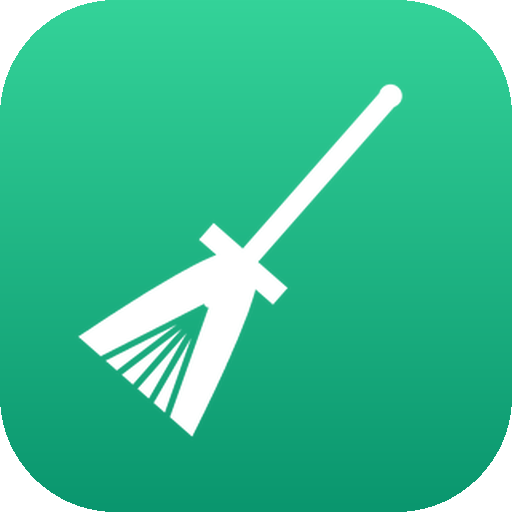

<div align="center">



# Miotła

**Safe cleanup for a developer's Mac, living in the macOS menu bar.**
See how much disk space is left and reclaim it with one click — removing only
caches your tools regenerate on their own. Everything in a window, not a terminal.

[](https://www.apple.com/macos/)
[](https://www.python.org/)
[](bin/miotla)
[](#-installation)
[](LICENSE)

**[🌐 Project site](https://rafalgawlik.github.io/miotla)** · **[💻 GitHub](https://github.com/rafalgawlik/miotla)**

</div>

---

The **🧹** icon sits in the menu bar next to the clock and shows free space.
Clicking it opens the menu:

```text
🧹 100 GB
  Free: 100.5 GB  ·  Used: 101 GB
  ⚡  Quick cleanup
  👀  Preview (what would be removed)
  🗂️  Full cleanup…
  Last cleanup: today, recovered 4.2 GB
  Open log
  ℹ︎  About Miotła
```

The number turns **orange below 40 GB** and **red below 20 GB**. One click runs a
safe cleanup; the broom sweeps in the bar while it works, and the result opens in
a window.

## ✨ Features

- 📊 **Free space in the menu bar** — always visible, color-coded by how much is left.
- ⚡ **Quick cleanup** — one click clears fully regenerable caches (an allow-list). No questions, runs in the background too.
- 🗂️ **Full cleanup in a window** — per-item checkboxes for specific emulators, Xcode Archives, old versions, caches… with a live "Selected: X" total. Pick exactly what to remove.
- 🔑 **System items too** — Time Machine snapshots and `sleepimage`, right from the window, with a native admin password prompt.
- 👀 **Preview first, always** — see what *would* be removed without deleting a thing.
- 🧹 **Animated broom** — the icon sweeps while a cleanup runs.
- 🛡️ **Safe by design** — deletes only inside your home folder; the `bin/miotla` engine refuses anything outside `$HOME`.
- 🖥️ **Native menu bar app** (`rumps`/pyobjc) on top of a battery-tested `bash` engine.

## 🚀 Installation

### Homebrew (recommended)

```bash
brew install rafalgawlik/tap/miotla
brew services start miotla
```

### As an app — launchable from the Dock, Launchpad & Spotlight

```bash
git clone https://github.com/rafalgawlik/miotla
cd miotla/app
./install-app.sh        # builds Miotła.app (py2app), adds a Login Item, launches it
```

Grant the app **Full Disk Access** (System Settings → Privacy & Security) so it can
see the Trash and app caches.

<details>
<summary><b>Alternatively: run from source / use the CLI</b></summary>

```bash
cd miotla/app && ./run.sh      # menu bar app from source (creates .venv)

# or just the engine from the command line:
bin/miotla --auto --dry-run    # preview a quick cleanup (removes nothing)
bin/miotla                     # full interactive cleanup in the terminal (Polish)
```
</details>

## 🧽 What it cleans

Only caches and build output your tools recreate on demand:

- 📦 **npm / Yarn** cache, **Homebrew** (`brew cleanup`)
- 🐘 **Gradle** — build-cache, old generations, old version caches & distributions (or the whole `~/.gradle/caches` on request)
- 🍎 **Xcode** — DerivedData, SPM/CocoaPods caches, `CoreSimulator/Caches`, DeviceSupport, old Archives
- 📱 **Android** — unused emulators, system images, NDK
- ⚛️ **Electron apps** — caches of Notion, Slack, VS Code… (skips running apps)
- 🐳 **Docker** — dangling images + build cache (never volumes)
- 🗑️ **Trash**, `~/.cache`, old IDE / Claude Code / Kotlin-Native versions
- 🔑 **System** (with a password) — Time Machine local snapshots, `sleepimage`

## 🔒 What Miotła never touches

- 🌐 **Browsers** — Brave, Chrome, Firefox, Safari, Arc, Edge (profiles & data)
- 💬 **Messengers** — Signal, WhatsApp and their databases
- ⚙️ **Program configuration** — settings, sign-ins and credentials of your tools and apps
- 📁 **Your work** — documents, source code and project files

Deletion happens **only inside `$HOME`** (the sole exceptions — Time Machine
snapshots and `sleepimage` — are always behind an explicit password prompt).

## 🗂️ Project structure

```
bin/miotla                 — the cleanup engine (bash 3.2): interactive +
                             --auto / --scan / --clean / --clean-items
swiftbar/miotla.10m.sh     — SwiftBar plugin (a lightweight alternative to the app)
app/                       — native menu bar app (rumps/pyobjc)
  miotla_app/              — the app package (engine bridge, windows, icon)
  install-app.sh           — build Miotła.app (py2app) + Login Item autostart
  setup_app.py             — py2app config
  packaging/homebrew/      — formula + release helper
assets/                    — icons + generator (make_icon.py, needs Pillow)
tests/                     — tests on a fake $HOME with stubbed tools
.github/workflows/ci.yml   — shellcheck + tests on macos-latest (real bash 3.2)
docs/index.html            — the project site (GitHub Pages)
```

## 🧪 Tests

```bash
tests/run.sh
```

Tests run on a fake home directory with stubbed tools (xcrun/docker/brew/pgrep…),
so they **never touch your real `$HOME`**. CI runs shellcheck + the suite on
`macos-latest`.

## 📦 Publishing via Homebrew (for the maintainer)

<details>
<summary><b>Expand the steps to cut a new release</b></summary>

```bash
# 1. tag + release (the tag drives the formula URL)
git tag v0.1.0 && git push origin v0.1.0
gh release create v0.1.0 --generate-notes

# 2. write the tarball sha256 into the formula
./app/packaging/homebrew/release-sha.sh 0.1.0

# 3. copy the formula into the tap repo `rafalgawlik/homebrew-tap`
cp app/packaging/homebrew/miotla.rb <tap>/Formula/miotla.rb
#    then commit & push the tap

# 4. anyone can now install:
brew install rafalgawlik/tap/miotla
```
</details>

## 🛣️ Roadmap

- [ ] Standalone `.app` (non-alias py2app) + a Homebrew **cask** with the icon
- [ ] Simulator runtimes & project `build/` dirs in the full-cleanup window
- [ ] Settings (thresholds, default categories)
- [ ] English CLI mode (the terminal engine is currently Polish)

## 📄 License & author

[MIT](LICENSE) © 2026 **Rafał Gawlik** — [rafalgawlik.com](https://rafalgawlik.com) · [@rafalgawlik](https://github.com/rafalgawlik)

<div align="center">
<sub>Built with bash · Python · <code>rumps</code> · pyobjc</sub>
</div>
